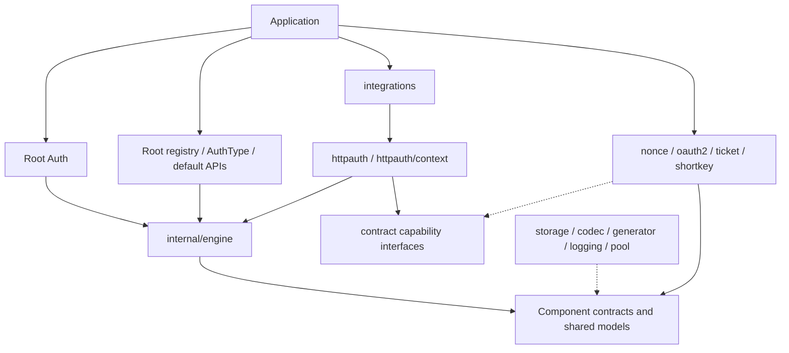

# Architecture

English | [中文文档](architecture_zh.md)

DToken-Go centers on a stateful authentication engine. Public contracts support replaceable components, independent services compose capabilities, and HTTP adapters integrate frameworks. This document describes responsibilities and connections; see [source layout](source-layout.md) for code locations.

## Responsibilities

| Area | Location | Responsibility |
| --- | --- | --- |
| Application entry | Root dtoken package | Auth instance APIs, application Builder, public options and types |
| Registry access | Root registry.go and default_*.go | Automatic registration, AuthType selection and default calls |
| Core authentication | internal/engine | Authentication state, Session, terminals, and core lifecycle |
| Assembly | internal/builder, internal/defaults | Generic component assembly and bundled default factories |
| Public foundations | contract, config, errors, event | Contracts, shared models, configuration, errors, and event services |
| Independent capabilities | nonce, oauth2, ticket, shortkey | Explicitly composed implementations and service wrappers |
| HTTP integration | httpauth, httpauth/context, integrations | Common checks, request scope, and framework adapters |
| Components | storage, codec, generator, logging, pool | Replaceable infrastructure implementations |

SSO retains its own modules and lifecycle. See the [SSO documentation](../../sso/README.md) for its internal design.

## Dependency direction

This diagram shows primary dependencies, omitting some configuration, error, and utility dependencies. Solid arrows indicate use; dotted arrows indicate contract implementation. Applications establish runtime service bindings.

- The engine depends on contracts, not concrete components, capabilities, or frameworks.
- Shared HTTP code depends on capability service interfaces, without importing implementations.
- The root owns the shared registry; Build registers automatically, BuildInstance remains isolated,.
- The root Builder is an assembly entry and can select bundled components. Component selection stays outside engine operations.

See [modular design](modular.md) for complete dependency rules and Go module releases. These layers describe responsibilities, not a requirement for one Go module per layer.

## Assembly path

1. Applications configure instances through the root NewBuilder, choosing components, factories, and engine options.
2. internal/defaults supplies bundled factories; internal/builder validates configuration, resolves components, and builds Manager.
3. Build registers and returns Auth; BuildInstance returns an unregistered Auth. Applications use instance operations, AuthType selectors, or default package functions; custom integrations may access Manager.
4. Applications separately create capability Managers or Servers and their Services. Bundled services can use an Auth configuration snapshot, Storage, Codec, and event emitter.
5. HTTP applications inject engines through WithAuth or WithManager and bind services through WithCapabilities. Registry lookup requires an explicit WithManagerResolver.

The three construction locations serve application configuration, generic assembly, and default wiring. Independent capabilities are not reintroduced into the core as Builder switches.

## Request and capability calls

| Call style | Main path |
| --- | --- |
| Instance operation | Application → Auth → engine → component contracts |
| Global operation | Application → root default/selected facade → shared registry → registered engine |
| HTTP core authentication | Framework adapter → shared HTTP checks or request context → engine |
| HTTP capability operation | Framework request entry → bound capability interface → service implementation |
| Direct capability operation | Application → explicitly constructed service → borrowed components |

Service interfaces isolate HTTP from implementations; they do not imply automatic discovery, construction, or ownership. Event emitters connect notifications from the engine and capabilities. Listener dispatch lives in event.

Manager organizes account coordination, Token maintenance, and runtime shutdown state within one implementation package. See the [engine file index](source-layout.md#engine-file-index). Correctness of concurrency, storage operations, and business flows is verified separately during feature reviews.

## Public API and lifecycle boundaries

Applications prefer Auth; Manager is a supported advanced API. Engine type aliases exposed by the root remain public APIs, with compatibility obligations even when their implementation path is internal. Shared models such as TokenInfo, Session, and TerminalInfo are declared in contract.

Auth facades, registry registration, and framework bindings may share one engine. Capability services borrow components, and event bindings do not transfer ownership. [API and lifecycle](api-lifecycle.md) is the source for construction, sharing, replacement, and shutdown contracts.

## Documentation responsibilities

| Document | Maintained content |
| --- | --- |
| This document | Responsibilities, dependencies, and assembly paths |
| [Source layout](source-layout.md) | Directories, file responsibilities, and code placement rules |
| [Modular design](modular.md) | Dependency constraints, Go module boundaries, and structural checks |
| [API and lifecycle](api-lifecycle.md) | Public APIs, component ownership, instance sharing, and shutdown |
| [Migration guide](module-migration.md) | Old-path migration, release ordering, and consumer verification |

Feature details live in [authentication](../guide/core/authentication.md), [Session and terminals](../guide/core/session-terminal.md), [permissions and roles](../guide/core/permission.md), [refresh tokens](../guide/security/refresh-token.md), and [auto-renewal design](auto-renew.md). [contract/model.go](../../contract/model.go) defines shared persisted models; storage namespaces are described in the [configuration guide](../guide/reference/configuration.md).
