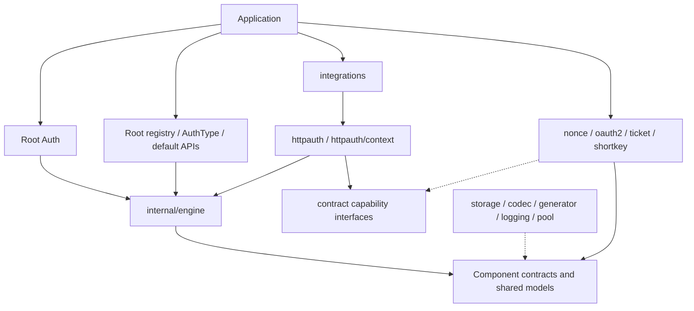

# Architecture

English | [中文文档](architecture_zh.md)

DToken-Go centers on a stateful authentication engine. Public contracts support replaceable components, independent services compose capabilities, and HTTP adapters integrate frameworks. This document describes responsibilities and connections; see [source layout](source-layout.md) for code locations.

## Responsibilities

| Area | Location | Responsibility |
| --- | --- | --- |
| Application entry | Root dtoken package | Auth instance APIs, application Builder, public options and types |
| Registry access | Root registry.go and default_*.go | Automatic registration, AuthType selection and default calls |
| Core authentication | internal/engine | Authentication state, Session, terminals, and core lifecycle |
| Assembly | internal/builder | Generic component assembly and bundled default factories |
| Public foundations | contract, config, errors, event | Contracts, shared models, configuration, errors, and event services |
| Independent capabilities | nonce, oauth2, ticket, shortkey | Explicitly composed implementations and service wrappers |
| HTTP integration | httpauth, httpauth/context, integrations | Common checks, request scope, and framework adapters |
| Components | storage, codec, generator, logging, pool | Replaceable infrastructure implementations |

SSO retains its own modules and lifecycle. See the [SSO documentation](../../sso/README.md) for its internal design.

## Dependency direction

This diagram shows primary dependencies, omitting some configuration, error, and utility dependencies. Solid arrows indicate use; dotted arrows indicate contract implementation. Applications establish runtime service bindings.

- The engine depends on contracts, not concrete components, capabilities, or frameworks.
- Shared HTTP code depends on capability service interfaces, without importing implementations.
- The root owns the shared registry; Build registers automatically, BuildInstance remains isolated,.
- The root Builder is an assembly entry and can select bundled components. Component selection stays outside engine operations.

See [modular design](modular.md) for complete dependency rules and Go module releases. These layers describe responsibilities, not a requirement for one Go module per layer.

## Assembly path

1. Applications configure instances through the root NewBuilder, choosing components, factories, and engine options.
2. The root Builder owns mutable configuration and component selections. Missing factories use functions from internal/builder/defaults.go; internal/builder.Build validates a configuration snapshot, resolves components, and constructs Manager.
3. Build registers and returns Auth; BuildInstance returns an unregistered Auth. Applications use instance operations, AuthType selectors, or default package functions; custom integrations may access Manager.
4. Applications separately create capability Managers or Servers and their Services. Bundled services can use an Auth configuration snapshot, Storage, Codec, and event emitter.
5. HTTP applications inject engines through WithAuth or WithManager and bind services through WithCapabilities. Registry lookup requires an explicit WithManagerResolver.

Only the root package defines a fluent Builder. internal/builder contains the stateless assembly function and bundled factories in defaults.go, without maintaining another Builder. Core configuration is validated once during assembly. Each factory still receives its own configuration copy so user callbacks cannot mutate sibling components or the running engine. Independent capabilities are not reintroduced into the core as Builder switches.

## Request and capability calls

| Call style | Main path |
| --- | --- |
| Instance operation | Application → Auth → engine → component contracts |
| Global operation | Application → root default/selected facade → shared registry → registered engine |
| HTTP core authentication | Framework adapter → shared HTTP checks or request context → engine |
| HTTP capability operation | Framework request entry → bound capability interface → service implementation |
| Direct capability operation | Application → explicitly constructed service → borrowed components |

Service interfaces isolate HTTP from implementations; they do not imply automatic discovery, construction, or ownership. Event emitters connect notifications from the engine and capabilities. Listener dispatch lives in event.

Manager organizes account coordination, Token maintenance, and runtime shutdown state within one implementation package. See the [engine file index](source-layout.md#engine-file-index). Correctness of concurrency, storage operations, and business flows is verified separately during feature reviews.

## Token storage and validation

Permissions and roles are resolved on demand. Token authorization validates credentials and builds `AccessSubject` before consulting the provider, without preloading Session. Session is read only when the provider is absent or returns nil; combined checks share that read and skip roles after permission rejection. Full introspection retains its separate Session validation.

New tokens use the engine-private `dtk:2:` primary format for identity, state, lifecycle ID, timeout settings, and terminal association, without embedding Extra. Storage TTL determines absolute expiration. Base checks read and parse small fields without the general Codec, Extra reads, or Session reads on the normal path. With inactivity timeout disabled, base login validation performs one foreground Token GET. Explicit access checks enforce restrictions synchronously; inactivity checks, permission queries, and background maintenance have separate costs.

Non-nil Extra creates a separate `token-extra:<accessID>` record using the configured Codec; empty maps are preserved. Token details, introspection, and refresh issuance load it when needed. Renewal maintains its lifetime, and logout, kickout, replacement, and refresh revocation remove it. Missing or corrupt extensions cause detail reads to fail without independently invalidating the primary credential or blocking logout. Account disabling retains its existing revoked-credential metadata behavior.

Sessions, refresh credentials, and capability objects still use Codec. Manager, Nonce, OAuth2, Ticket, and ShortKey share `{encoded KeyPrefix}{encoded AuthType}v2:` without falling back to unversioned storage. Upgrade using [PrepareAuthUpgrade](namespace-copy.md) during a stopped-writer window. Runtime access credentials accept only compact records with an explicit AuthType and AccessID; legacy Token Codec decoding and anonymous writes have been removed. Restrictions now read only their canonical key and require explicit ownership and kind; legacy key interpretation is confined to offline migration. Terminal pruning follows policy scopes and count thresholds, avoiding unconditional token probes during login; Session reads and writes remain. See the [implementation plan (Chinese)](performance-refactor-plan_zh.md) for progress.

## Independent capability operations

Independent capabilities coordinate writes only for the credential involved: ShortKey serializes creation, confirmation, consumption, and revocation per key; Ticket does the same for ordinary-storage consumption and revocation. Lock entries are reclaimed after holders and waiters leave. This coordination is local to one Manager and does not replace cross-instance atomic storage capabilities.

Ticket, ShortKey, and OAuth2 Service revocation reuse the record processed by the internal operation to emit events, avoiding extra credential reads and decoding. Each normal revocation reads once; pending ShortKeys retain their existing event fields. OAuth2 combines access-token and refresh-token removal into one Delete call without requiring multi-key transactions. Public APIs and one-time consumption checks remain unchanged.

## Public API and lifecycle boundaries

Applications prefer Auth; Manager is a supported advanced API. Engine type aliases exposed by the root remain public APIs, with compatibility obligations even when their implementation path is internal. Shared models such as TokenInfo, Session, and TerminalInfo are declared in contract.

Auth facades, registry registration, and framework bindings may share one engine. Capability services borrow components, and event bindings do not transfer ownership. [API and lifecycle](api-lifecycle.md) is the source for construction, sharing, replacement, and shutdown contracts.

## Documentation responsibilities

| Document | Maintained content |
| --- | --- |
| This document | Responsibilities, dependencies, and assembly paths |
| [Source layout](source-layout.md) | Directories, file responsibilities, and code placement rules |
| [Modular design](modular.md) | Dependency constraints, Go module boundaries, and structural checks |
| [API and lifecycle](api-lifecycle.md) | Public APIs, component ownership, instance sharing, and shutdown |
| [Migration guide](module-migration.md) | Old-path migration, release ordering, and consumer verification |

Feature details live in [authentication](../guide/core/authentication.md), [Session and terminals](../guide/core/session-terminal.md), [permissions and roles](../guide/core/permission.md), [refresh tokens](../guide/security/refresh-token.md), and [auto-renewal design](auto-renew.md). [contract/model.go](../../contract/model.go) defines public shared models; [internal_token_record.go](../../internal/engine/internal_token_record.go) defines the private token primary format. Storage namespaces are described in the [configuration guide](../guide/reference/configuration.md).
