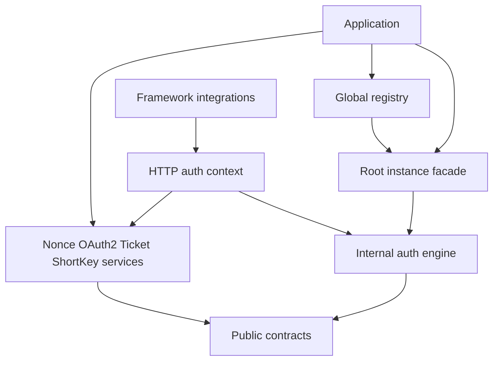

English | [中文文档](architecture_zh.md)

# Architecture



The root package provides instance APIs and construction; `global` owns registration and global convenience calls. Authentication implementation lives in `internal/engine`; applications import public extension types from the root or `contract`.

Compose capabilities through their Manager and Service constructors, then bind request services with `WithCapabilities`. The engine does not depend on capabilities. Framework packages adapt requests, responses, and middleware. Instance APIs require no global registration.

## Manager implementation boundaries

`internal/engine` keeps the public facade in `manager.go` and public persisted models in `model.go`. Internal files organize state ownership and shared operations inside the same package.

| File | Responsibility |
| --- | --- |
| `constructor.go` | Component assembly, options, default ownership |
| `internal_lifecycle.go` | Task admission, instance-owned background tasks, shutdown and resource release |
| `internal_account_lock.go` | Account write lock registry and lock lifetime |
| `internal_maintenance.go` | Token maintenance generations and merged activity timestamps |
| `internal_storage.go` | Persistence, expiration conversion and renewal primitives |
| `internal_access_mutation.go` | Permission/role changes, locked token revalidation, persistence and event sequencing |
| `internal_access_values.go` | Session permission/role list operations |
| `internal_terminal.go` | Session terminal selection and mutation |

Manager owns three private state groups for account locks, token maintenance, and runtime shutdown. Background logging state belongs directly to each instance. Shutdown rejects new tasks, drains background workers, accepted work and listeners, then releases owned pool, storage and logging resources in order.

Permission and role mutation APIs delegate to two common flows, by account or by token. Token mutations capture the lifecycle before locking and revalidate under the account lock. The flow saves actual changes, releases the lock before listener callbacks, and submits prepared maintenance after unlocking. Existing login, refresh and termination operations continue using the shared account locks and token lifecycle primitives.

## Module Division

The root owns instance APIs; global owns registration. Authentication implementation lives in internal/engine, with public contracts in contract. Nonce, OAuth2, Ticket, and ShortKey compose as independent services. HTTP contexts bind services explicitly; frameworks adapt requests and middleware.

Components live in codec, generator, logging, pool, and storage. SSO retains its independent module and lifecycle. See [modular design](modular.md) and the [migration guide](module-migration.md).

In code fragments, dt aliases the root and dtoken aliases global.

## Design Patterns

### 1. Builder Pattern

```go
mgr, err := dt.NewBuilder().
    Storage(memory.NewStorage()).
    TokenName("Authorization").
    Timeout(86400).
    Build()
if err != nil {
    panic(err)
}
```

**Advantages**:
- fluent and readable configuration
- flexible optional parameters
- easy to extend with new config items

### 2. Adapter Pattern

```go
type Storage interface {
    Set(ctx context.Context, key string, value any, expiration time.Duration) error
    Get(ctx context.Context, key string) (any, error)
    Delete(ctx context.Context, keys ...string) error
    Exists(ctx context.Context, key string) bool
    Expire(ctx context.Context, key string, expiration time.Duration) error
    TTL(ctx context.Context, key string) (time.Duration, error)
    Ping(ctx context.Context) error
}
```

**Advantages**:
- decouples concrete implementations
- makes storage, logging, codec, pool, and generator replaceable
- keeps the core layer implementation-agnostic

### 3. Middleware / Annotation-Style Composition

```go
annotation.GET("/profile",
    gindt.CheckLoginMiddleware(ctx, handleProfile, handleAuthFail))
```

**Advantages**:
- unified integration style across frameworks
- reusable login, permission, and role checks
- closer to real business routing style

### 4. Global Manager Registry Pattern

```go
dtoken.SetManager(mgr.Manager())
registered, err := dtoken.GetManager()
```

**Advantages**:
- supports global access
- supports multiple auth systems
- avoids passing manager objects throughout business code

## Data Flow

### Login Flow

```text
Request
  ↓
dtoken.Login(ctx, loginID, ...)
  ↓
1. Parse device / deviceID / authType
  ↓
2. Generate token
  ↓
3. Save Session without shortening its existing TTL
  ↓
4. Save TokenInfo
  ↓
5. Initialize renew / active state
  ↓
6. Return token
```

### Token Validation Flow

```text
Request
  ↓
dtoken.IsLogin(ctx, token)
  ↓
1. Validate TokenInfo and its Session / terminal binding
  ↓
2. Check account and device disable state
  ↓
3. Check ActiveTimeout
  ↓
4. Schedule combined renewal / activity maintenance as needed
  ↓
5. Worker rechecks lifecycle before writing; activity uses request time
  ↓
6. Return validation result
```

### Permission Validation Flow

```text
Request
  ↓
CheckPermissionMiddleware / HasPermission
  ↓
1. Get token or loginID
  ↓
2. Middleware and token-based APIs validate login state
  ↓
3. Load permission list
  ↓
4. Match permissions (with wildcard support)
  ↓
5. Trigger permission-check event
  ↓
6. Return result
```

Account-based `HasPermission(ctx, loginID, ...)` resolves permissions by account, including through an AccessProvider, and does not prove possession of a valid login token. Protect request handlers with authentication middleware or a token-based check.

## Auto-Renew Design

### Core Idea

The current version does not simply renew on every `IsLogin()` call. Instead it:

- checks the current token TTL first
- only renews when the token is close enough to expiry
- throttles renew operations through `RenewInterval`
- prefers submitting renew work to an async pool

### Current Implementation Highlights

- `AutoRenew` controls whether auto-renew is enabled
- `RenewMaxRefresh` controls when renew should trigger
- `RenewInterval` controls the minimum renew interval for the same token
- `ActiveTimeout` controls the maximum inactive duration
- `pool/ants` provides the default renew task pool

See: [Auto-Renew Design](auto-renew.md)

## Data Storage Structure

### Storage Key Structure

Current keys are composed as:

`encoded KeyPrefix + encoded AuthType + businessPrefix + businessID`

Namespace components escape internal separators independently. See [Namespace Rules](../guide/reference/configuration.md#namespace-rules) before interpreting keys with internal colons or backslashes.

With default values, common key examples are:

```text
dtoken:auth:token:{tokenValue}                   -> TokenInfo
dtoken:auth:session:{loginID}                   -> Session
dtoken:auth:renew:{tokenValue}                  -> renew throttle marker
dtoken:auth:active:{tokenValue}                 -> last active timestamp
dtoken:auth:disable:{loginID}                   -> account disable info
dtoken:auth:disable:service:{loginID}:{service} -> service disable info
```

### TokenInfo Structure

```go
type TokenInfo struct {
    AuthType      string
    LoginID       string
    Device        string
    DeviceID      string
    CreateTime    int64
    Timeout       int64
    ActiveTimeout int64
    Extra         map[string]any
}
```

### Session Structure

```go
type Session struct {
    AuthType             string
    LoginID              string
    CreateTime           int64
    TerminalInfos        []TerminalInfo
    Permissions          []string
    Roles                []string
    Data                 map[string]any
    HistoryTerminalCount int64
}
```

## Next Steps

- [Auto-Renew Design](auto-renew.md)
- [Modular Design](modular.md)
- [DToken API Documentation](../api/dtoken.md)
