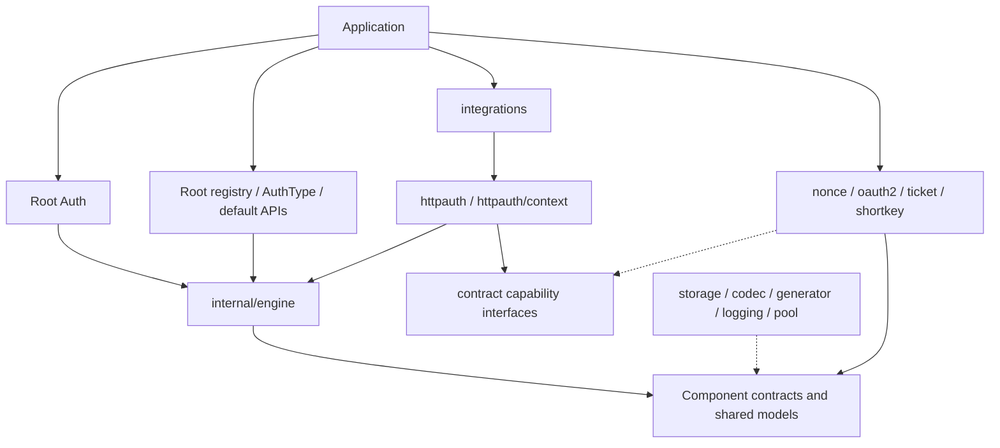

# 架构设计

[English](architecture.md) | 中文文档

DToken-Go 以有状态认证引擎为核心，通过公共契约替换组件，通过独立服务组合附加能力，通过 HTTP 适配层接入框架。本文描述各部分的职责和连接方式；源码位置见[源码目录](source-layout_zh.md)。

## 职责分层

| 区域 | 位置 | 职责 |
| --- | --- | --- |
| 应用入口 | 根包 dtoken | Auth 实例 API、应用 Builder、公开选项与类型 |
| 注册表访问 | 根 registry.go 与 default_*.go | 自动注册、AuthType 选择及默认调用 |
| 核心认证 | internal/engine | 认证状态、Session、终端和核心生命周期 |
| 装配 | internal/builder | 通用组件装配与内置默认工厂 |
| 公共基础 | contract、config、errors、event | 契约、共享模型、配置、错误和事件服务 |
| 独立能力 | nonce、oauth2、ticket、shortkey | 显式组合的能力实现与服务封装 |
| HTTP 接入 | httpauth、httpauth/context、integrations | 公共请求鉴权、请求作用域与框架适配 |
| 基础组件 | storage、codec、generator、logging、pool | 可替换的基础设施实现 |

SSO 保留独立模块和生命周期，内部设计见 [SSO 文档](../../sso/README_zh.md)。

## 依赖方向

下图展示主要依赖，省略部分配置、错误和辅助工具依赖。实线表示使用，虚线表示实现契约；运行时的服务绑定由应用完成。

- 核心引擎依赖契约，不依赖具体组件、独立能力或框架。
- HTTP 公共层依赖能力服务接口，不导入能力实现。
- 根包持有共享注册表；Build 自动注册，BuildInstance 保持独立。
- 根 Builder 是装配入口，可以选择内置组件；组件选择不进入引擎业务代码。

完整依赖规则和 Go 模块发布范围见[模块化设计](modular_zh.md)。这里的层次按职责划分，不要求每层独立成为 Go 模块。

## 装配路径

1. 应用使用根 NewBuilder 配置认证实例，选择组件、组件工厂和引擎选项。
2. 根 Builder 保存唯一一份可修改的配置和组件选择；未指定工厂时使用 internal/builder/defaults.go 中的函数，再调用 internal/builder.Build 校验配置快照、解析组件并构建 Manager。
3. Build 注册并返回 Auth；BuildInstance 返回未注册的 Auth。应用可调用实例、AuthType 选择器或默认包级函数，自定义集成按需访问 Manager。
4. 应用单独创建所需能力的 Manager 或 Server，再创建 Service。内置服务可使用 Auth 的配置快照、Storage、Codec 和事件发布入口。
5. HTTP 应用通过 WithAuth 或 WithManager 注入引擎，通过 WithCapabilities 绑定能力服务。注册表查找须显式注入 WithManagerResolver。

只有根包定义链式 Builder。internal/builder 集中提供无状态装配函数和 defaults.go 中的默认组件工厂，不维护另一套 Builder。核心配置在装配时校验一次，各工厂仍接收独立配置副本，防止用户工厂修改其他组件或运行中的引擎配置。独立能力不作为 Builder 开关重新装回核心。

## 请求与能力调用

| 调用方式 | 主要路径 |
| --- | --- |
| 实例调用 | 应用 → Auth → 核心引擎 → 组件契约 |
| 全局调用 | 应用 → 根默认/指定门面→ 共享注册表 → 已注册的引擎 |
| HTTP 核心鉴权 | 框架适配器 → HTTP 公共检查或请求上下文 → 引擎 |
| HTTP 能力调用 | 框架请求入口 → 请求中绑定的能力接口 → 服务实现 |
| 直接能力调用 | 应用 → 显式构建的能力服务 → 借用的组件 |

服务接口用于隔离 HTTP 与能力实现，不表示框架自动发现、创建或管理这些服务。事件发布器连接核心与能力的事件通知；事件分发本身位于 event 包。

Manager 在同一实现包中组织账号协调、Token 维护和运行时关闭状态。文件职责见[引擎文件索引](source-layout_zh.md#核心引擎文件索引)。并发控制、存储操作和业务流程的正确性由后续功能校验单独确认。

## 公开 API 与生命周期边界

应用首选 Auth，Manager 是受支持的高级 API。根包暴露的引擎类型别名仍属于公开 API；实现路径位于 internal 并不会取消其兼容性要求。TokenInfo、Session、TerminalInfo 等共享模型以 contract 为声明来源。

Auth 门面、全局注册和框架绑定可以共享同一引擎。能力服务借用组件，事件绑定不会转移资源所有权。创建、共享、替换和关闭的完整约定以 [API 与生命周期](api-lifecycle_zh.md) 为准。

## 文档分工

| 文档 | 维护内容 |
| --- | --- |
| 本文 | 系统职责、依赖关系与装配路径 |
| [源码目录](source-layout_zh.md) | 目录、文件职责和新增代码的放置规则 |
| [模块化设计](modular_zh.md) | 包依赖约束、Go 模块边界及现有结构检查 |
| [API 与生命周期](api-lifecycle_zh.md) | 公开 API、组件所有权、实例共享和关闭 |
| [迁移指南](module-migration_zh.md) | 旧路径迁移、发布顺序及消费者验证步骤 |

功能细节分别维护在[登录认证](../guide/core/authentication_zh.md)、[Session 与终端](../guide/core/session-terminal_zh.md)、[权限与角色](../guide/core/permission_zh.md)、[刷新令牌](../guide/security/refresh-token_zh.md)和[自动续签设计](auto-renew_zh.md)中。持久化共享模型以 [contract/model.go](../../contract/model.go) 为准，存储命名空间见[配置指南](../guide/reference/configuration_zh.md)。
