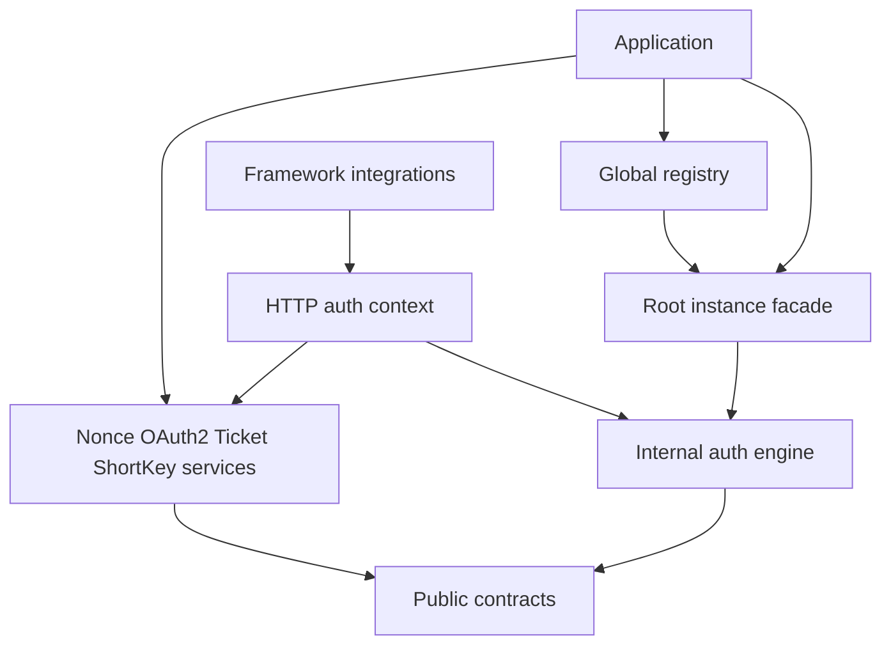

[English](architecture.md) | 中文文档

# 架构设计



根包只提供实例 API 与构建入口，`global` 管理注册表和全局便捷调用。认证实现位于 `internal/engine`；公共扩展类型从根包或 `contract` 导入。

独立能力通过各自的 Manager 与 Service 构造器显式组合，通过 `WithCapabilities` 绑定请求上下文。核心引擎不依赖这些能力，框架只适配请求、响应和中间件。实例 API 无需全局注册。

## Manager 实现边界

`internal/engine` 将公开门面放在 `manager.go`，公开持久化模型放在 `model.go`。内部文件在同一个包中按状态所有权与共享操作组织。

| 文件 | 职责 |
| --- | --- |
| `constructor.go` | 组件装配、选项与默认所有权 |
| `internal_lifecycle.go` | 任务接收、实例自有后台任务、关闭与资源释放 |
| `internal_account_lock.go` | 账号写锁注册表与锁生命周期 |
| `internal_maintenance.go` | Token 维护代次与活跃时间合并 |
| `internal_storage.go` | 持久化、过期时间转换与续期基础操作 |
| `internal_access_mutation.go` | 权限与角色变更、锁内 Token 复核、持久化与事件顺序 |
| `internal_access_values.go` | Session 权限与角色列表操作 |
| `internal_terminal.go` | Session 终端筛选与修改 |

Manager 内部按账号锁、Token 维护和运行时关闭划分三组私有状态，后台状态日志由各实例直接持有。关闭时依次拒绝新任务，等待后台任务、已接收任务和监听器完成，再按所有权释放协程池、存储和日志资源。

权限与角色变更 API 共用按账号和按 Token 两条流程。Token 变更先捕获生命周期，再在账号锁内复核。流程仅保存实际变化，在监听器回调前释放锁，已准备的维护任务也在解锁后提交。登录、刷新和终端下线继续通过共享账号锁与 Token 生命周期基础操作协调。

## 模块划分

根包负责实例门面，global 负责全局注册表。认证实现位于 internal/engine，公共组件契约位于 contract。Nonce、OAuth2、Ticket、ShortKey 通过独立服务组合，HTTP 上下文显式绑定服务；框架只负责请求适配和中间件。

具体组件位于 codec、generator、logging、pool、storage。SSO 保持独立模块与生命周期。详见[模块化设计](modular_zh.md)和[迁移指南](module-migration_zh.md)。

代码片段中 dt 是根包的导入别名，dtoken 是 global 包的导入别名。

## 设计模式

### 1. Builder 模式

```go
mgr, err := dt.NewBuilder().
    Storage(memory.NewStorage()).
    TokenName("Authorization").
    Timeout(86400).
    Build()
if err != nil {
    panic(err)
}
```

**优势**：
- 链式调用，配置清晰
- 可选参数灵活组合
- 便于后续扩展配置项

### 2. 适配器模式

```go
type Storage interface {
    Set(ctx context.Context, key string, value any, expiration time.Duration) error
    Get(ctx context.Context, key string) (any, error)
    Delete(ctx context.Context, keys ...string) error
    Exists(ctx context.Context, key string) bool
    Expire(ctx context.Context, key string, expiration time.Duration) error
    TTL(ctx context.Context, key string) (time.Duration, error)
    Ping(ctx context.Context) error
}
```

**优势**：
- 解耦具体实现
- 便于替换存储、日志、编解码、协程池
- 所有组件都可以独立扩展

### 3. 中间件 / 注解式封装

```go
annotation.GET("/profile",
    gindt.CheckLoginMiddleware(ctx, handleProfile, handleAuthFail))
```

**优势**：
- 框架集成风格统一
- 登录、权限、角色校验可复用可组合
- 更贴近业务路由写法

### 4. 全局 Manager 注册模式

```go
dtoken.SetManager(mgr.Manager())
registered, err := dtoken.GetManager()
```

**优势**：
- 支持全局统一调用
- 支持多认证体系并存
- 不需要在业务层层传递 Manager

## 数据流转

### 登录流程

```text
请求
  ↓
dtoken.Login(ctx, loginID, ...)
  ↓
1. 解析 device / deviceID / authType
  ↓
2. 生成 Token
  ↓
3. 保存 Session，保留已有的更长 TTL
  ↓
4. 保存 TokenInfo
  ↓
5. 初始化续期 / 活跃状态
  ↓
6. 返回 Token
```

### Token 校验流程

```text
请求
  ↓
dtoken.IsLogin(ctx, token)
  ↓
1. 校验 TokenInfo 及其 Session、终端绑定
  ↓
2. 检查账号和设备封禁状态
  ↓
3. 检查 ActiveTimeout
  ↓
4. 按需调度合并的续期和活跃维护任务
  ↓
5. 任务写入前复核生命周期，活跃时间采用请求时间
  ↓
6. 返回校验结果
```

### 权限校验流程

```text
请求
  ↓
CheckPermissionMiddleware / HasPermission
  ↓
1. 获取 Token 或 loginID
  ↓
2. 中间件和基于 Token 的接口校验登录状态
  ↓
3. 获取权限列表
  ↓
4. 执行权限匹配（支持通配符）
  ↓
5. 触发权限校验事件
  ↓
6. 返回结果
```

按账号调用的 `HasPermission(ctx, loginID, ...)` 从账号或 AccessProvider 解析权限，不代表调用者持有有效登录 Token。请求处理应搭配认证中间件或基于 Token 的校验。

## 自动续签设计

### 核心思想

当前版本的自动续签不是简单的“每次 `IsLogin()` 都续期”，而是：

- 先检查 Token 当前 TTL
- 只有在接近过期时才触发续期
- 通过 `RenewInterval` 控制最小续期间隔
- 优先提交到异步协程池执行

### 当前实现要点

- `AutoRenew` 控制是否开启自动续签
- `RenewMaxRefresh` 控制何时触发续期
- `RenewInterval` 控制同一 Token 的最小续期间隔
- `ActiveTimeout` 控制最大不活跃时长
- `pool/ants` 提供默认续期任务协程池

详见：[自动续签设计](auto-renew_zh.md)

## 数据存储结构

### Storage 键结构

当前 Key 由：

`编码后的 KeyPrefix + 编码后的 AuthType + 业务前缀 + 业务标识`

命名空间各部分会独立转义内部分隔符。分析包含内部冒号或反斜杠的键之前，请参阅[命名空间规则](../guide/reference/configuration_zh.md)。

组成，默认前缀示例如下：

```text
dtoken:auth:token:{tokenValue}              -> TokenInfo
dtoken:auth:session:{loginID}              -> Session
dtoken:auth:renew:{tokenValue}             -> 续期节流标记
dtoken:auth:active:{tokenValue}            -> 最近活跃时间
dtoken:auth:disable:{loginID}              -> 账号封禁信息
dtoken:auth:disable:service:{loginID}:{service} -> 服务封禁信息
```

### TokenInfo 结构

```go
type TokenInfo struct {
    AuthType      string
    LoginID       string
    Device        string
    DeviceID      string
    CreateTime    int64
    Timeout       int64
    ActiveTimeout int64
    Extra         map[string]any
}
```

### Session 结构

```go
type Session struct {
    AuthType             string
    LoginID              string
    CreateTime           int64
    TerminalInfos        []TerminalInfo
    Permissions          []string
    Roles                []string
    Data                 map[string]any
    HistoryTerminalCount int64
}
```

## 下一步

- [自动续签设计](auto-renew_zh.md)
- [模块化设计](modular_zh.md)
- [DToken API 文档](../api/dtoken_zh.md)
