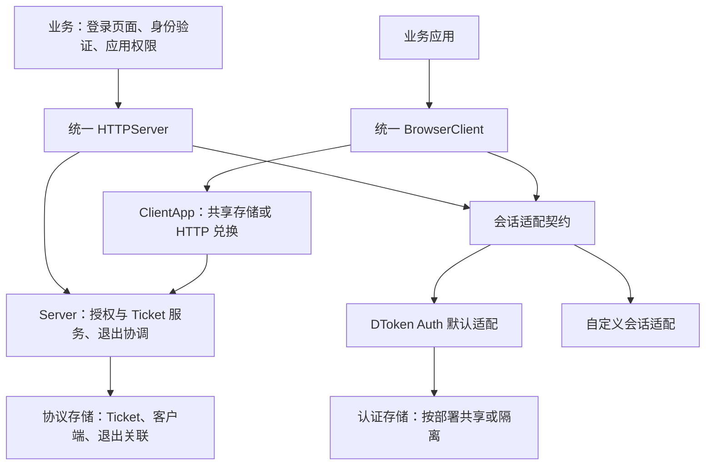
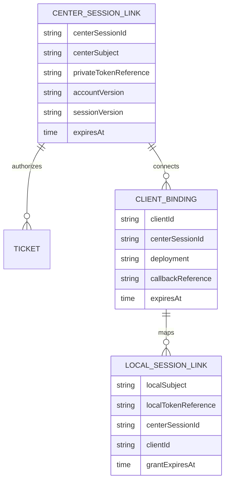

# SSO 架构设计：统一中心与三种部署方式

状态：SSO 模块架构方案 v0.2，2026-11-26。本文基于本地 Sa-Token Java 源码和 Go 实现整理，不代表兼容 Sa-Token 网络协议。设计之后已开始阶段 A 实现，当前接口与进展见[公共兑换核心与会话契约](EXCHANGE_CORE_zh.md)；本文其余待实现内容仍是目标架构，不代表完整运行能力。

范围：只设计 SSO 这个模块。DToken Auth、根注册表、存储契约、Ticket／OAuth2 独立能力模块及框架集成均视为现有外部依赖，不安排改造。SSO 通过已有公开 API 组合它们。后续若发现依赖缺少必要能力，先记录边界，不在本设计名义下扩展其他模块。

阅读顺序：第 1–9 节说明依据与总体结构；第 12–18 节定义包边界、交互契约、数据、状态、兼容及验收。具体公开标识符以阶段说明和源码为准，本文伪签名与目标流程不可直接当作当前可编译 API。

## 1. 设计目标

一个统一认证中心，按应用部署条件完成一次登录、多应用认可和统一退出。SSO 组合 DToken 的认证会话能力，不另建一套用户会话引擎。业务接入认证函数、配置应用与存储、挂载处理器即可使用完整流程；高级用户仍可替换会话处理。

成功标准：

1. 三种部署方式各有完整的登录、再次访问和退出流程，使用同一中心授权入口。
2. 模式二与模式三复用 Ticket 消费规则，只切换兑换通道及会话存储配置。
3. 中心和客户端都有可直接使用的 DToken Auth 适配，不要求每个项目重写会话钩子。
4. 同一中心下混合三类应用，全局退出能覆盖共享与独立会话；当前浏览器退出不能误退其他浏览器。
5. 旧 API、默认 HTTP 兑换、已实现的签名、PKCE、state、防重放和通知机制保持兼容。

## 2. Java 版实际如何组织

以下路径均相对于本地 `Sa-Token` 仓库，描述的是本次阅读的检出版本。

| Java 组件 | 实际职责 | 对 Go 设计的启示 |
| --- | --- | --- |
| `sso/processor/SaSsoServerProcessor` | 分发授权、登录提交、注销和消息；`ssoAuth()` 先检查中心登录，再选择 simple 直接返回或 ticket 返回 | 同一个中心处理三种形式；先复用中心会话，再决定如何交付登录结果 |
| `sso/processor/SaSsoClientProcessor` | 登录跳转、Ticket 回调、建立会话、退出；`checkTicket()` 根据 `isHttp` 选择校验通道 | 模式二、三共用客户端编排 |
| `sso/template/SaSsoTemplate` | 注入或取得 `StpLogic`，保存 API／参数名称及消息处理入口 | 会话能力由基础认证组件提供 |
| `SaSsoServerTemplate` | Ticket 创建与消费、客户端配置、返回地址校验、退出登记与通知 | 协议规则应从 HTTP 适配中分离，供不同通道复用 |
| `SaSsoClientTemplate` | 授权地址、签名消息、请求中心注销、补充本地注销 | 客户端辅助与中心职责分开 |
| `SaSsoServerStrategy` / `SaSsoClientStrategy` | 登录页、账号校验、返回数据补充、身份映射及传输扩展 | 默认接入可用，业务边界可替换 |
| `SaSsoManager` 与 Spring 注入 | 提供全局配置和实例装配 | Go 使用显式构造与依赖注入，不照搬全局单例和 Java 继承 |

上述包位于 `sa-token-plugin/sa-token-sso/src/main/java/cn/dev33/satoken/`。

重要证据：

- `SaSsoServerProcessor.ssoAuth()`：`mode=simple` 校验返回地址后直接返回；其余常规路径签发 Ticket。服务端没有三套登录实现。
- `SaSsoClientProcessor._loginByTicket()`：校验结果统一进入 `StpLogic.login`，携带剩余有效期和设备 ID；允许 `ticketResultHandle` 替换处理。
- `_checkTicketByRedis()`：调用服务端模板消费 Ticket，并通过共享的 `StpLogic` 读取中心 Token 的设备及有效期。并非只读取一个账号 ID。
- `SaSsoMessageCheckTicketHandle`：HTTP 路径也返回账号、中心 Token、设备、剩余有效期，并登记注销信息。
- `SaSsoClientProcessor.ssoLogout()`：明确要求模式二和三都向中心发起全局注销，避免漏掉独立会话应用。
- 模式一示例读取 `StpUtil` 登录状态，向同一个授权入口发送 `mode=simple`；浏览器及账号级注销也跳转中心。
- `sa-token-doc/sso/sso-type3.md` 明确指出：不共享 Redis 后，客户端不能共用中心会话，须维护子会话并处理注销通知。

## 3. 先明确三种会话模型

| 部署形式 | 浏览器 Token | 认证会话存储 | 登录结果处理 |
| --- | --- | --- | --- |
| 模式一：共享 Cookie 同步会话 | 同域 Cookie 共享同一个 Token | 中心与应用共享 Auth 存储及命名空间 | 中心登录后返回；应用直接验证已有共享会话，不再次登录 |
| 模式二：URL 重定向传播会话 | 各域有自己的 Cookie；不要求各域 Token 字符串相同 | 中心与应用共享认证存储及账号会话体系 | Ticket 在共享存储中校验；按中心身份、设备关联和期限建立可关联的登录终端 |
| 模式三：HTTP 请求获取会话 | 各域维护自己的 Token | 中心与应用独立认证存储 | HTTP 校验 Ticket；建立关联中心会话的本地子会话，退出靠通知联动 |

模式二的“共享会话”不等于“必须使用同一个 Token”，也不等于“只共享 Ticket 所在 Redis”。共享协议数据、共享 Auth 数据以及共享 Cookie 是三个不同条件。

当前 Go 的 `SharedStoreServer` 只保证共享协议存储兑换；`BrowserLoginFunc` 仍可创建完全隔离的 Auth 会话。这是一种可用组合，但不足以据此声称已完整实现 Java 模式二的会话语义。现有 `DEPLOYMENT_MODES` 中关于模式二独立本地会话及回调的说明，应理解为当前实现的行为，后续须随标准 Auth 接入修订。

## 4. Go 的目标结构

保留现有对象，不为每种模式再建一套 Server、Client、Session 引擎。以下名称中的新增项是设计概念，具体公开签名在实现前收敛。



职责分配：

- `Server` 保留协议核心，承载可被 HTTP 和本地兑换调用的类型化服务。输入是经过结构化的请求及 Context，输出是结构化结果及错误。
- `HTTPServer` 解析与限制 HTTP 输入、校验传输认证、读取中心会话、调用核心、生成响应。增加共享会话授权分支，沿用同一入口。
- `ClientApp` 构造中心请求，选择共享存储或 HTTP 通道；不承担创建用户会话。
- `BrowserClient` 管理登录导航、state、回调及本地返回地址，根据部署配置调用会话适配。不另建与它并行的模式一浏览器组件。
- 会话接入分为浏览器绑定与会话后端：绑定读取 Token、写入与清理 Cookie；后端查询、建立和撤销会话。默认后端调用 `dtoken.Auth`，核心接口不暴露 HTTP 或 internal engine 类型。
- 业务验证函数负责用户名密码、短信或其他身份源，返回已验证主体；它与 Auth 建立会话是两个步骤。保留自定义登录页和已有业务钩子。

模式一可复用适配内部的 Cookie 工具，但不再创建一套独立的中心登录和全局退出控制器。

## 5. 配置与协议分开

客户端增加独立的部署选择概念，例如 `SharedCookie`、`SharedStore`、`HTTP`。这些是拟议枚举值，不改写现有 `ModeTicket` 等凭证类型。

| 配置维度 | 用途 |
| --- | --- |
| 部署方式 | 决定共享 Cookie、直连兑换或 HTTP 兑换及所需会话依赖 |
| 授权流程 | 中心选择 simple 返回或 Ticket 返回；与 Java 思路一致，但不要求相同参数名 |
| 凭证类型 | 保留 Ticket 默认及既有 Code 等高级能力，避免把它们当成部署形式 |
| 会话绑定 | 注入 Auth 或自定义适配、Cookie、认证存储和命名空间 |
| 客户端登记 | 允许的授权流程、回调地址、签名配置和退出通知地址 |

兼容规则：

- 未指定新部署配置时继续使用现有行为，不能改变默认 HTTP 兑换。
- 已有 `UseHTTPCheck`、`SharedStoreServer` 继续支持；显式新配置与旧配置冲突时启动拒绝，不静默覆盖或失败后切换通道。
- 中心登记须显式允许 simple 流程，浏览器传一个参数不能让所有客户端自动进入共享会话模式。
- 新流程参数不与现有凭证 `Mode` 混用；旧协议缺少该参数时仍按既有流程运行。
- 三种模式都提供默认 Auth 接入，原有钩子是替换扩展；同一职责不能同时执行默认实现与自定义钩子。
- 框架不通过连接地址猜测 Redis 是否真正共享；配置校验检查可见的一致性，跨进程连接与数据范围由部署验证确认。

## 6. 三条登录流程

### 模式一

1. 应用用会话适配检查共享 Cookie 对应的 Auth 登录状态。
2. 未登录时保存返回路径和浏览器绑定 state，跳转中心同一授权入口，选择 simple 流程。
3. 中心通过同一会话适配判断登录；需要认证时交给业务登录页与身份验证函数。
4. 成功建立中心 Auth 会话，写入共享域 Cookie；中心校验已登记回调后返回，不签发 Ticket。
5. 应用回调消费 state，重新读取共享 Cookie 并验证 Auth 会话，恢复原页面，不另建 Token。

这里保留 Go 已有浏览器 state 机制，因此建议返回固定回调，再恢复本地路径；Java 示例直接返回业务页面，不必逐字照搬。Cookie 未共享成功时应明确失败，不能进入无限登录跳转。

### 模式二

1. 应用没有本域登录状态时，走同一个 BrowserClient 发起 Ticket 授权。
2. 中心复用或建立中心会话，签发绑定客户端、回调、PKCE 和中心会话关联的 Ticket。
3. 应用直接调用协议核心消费共享存储 Ticket，读取可信会话元数据。
4. 默认 Auth 适配在共同认证存储及命名空间内建立本域终端，保留中心设备／会话关联，限制到中心剩余期限。
5. 应用写本域 Cookie 并返回原页面。不同浏览器须有不同关联标识；不能用同一个账号 ID 代替浏览器会话标识。

### 模式三

浏览器过程与模式二一致，差别是应用通过 HTTP 调用同一个 Ticket 服务，并在独立 Auth 存储建立子会话。应用须持久化中心与本地会话的关联，供通知准确撤销。

Ticket 的寿命是兑换窗口，不是本地登录寿命。中心会话的有效期、应用上限及注销关联要由默认适配明确处理，不能仅依赖 `SessionMaxAge` 或由业务猜测。

## 7. 会话适配的数据和生命周期

适配契约按实际调用职责划分，不新增通用插件框架：

| 操作 | 契约 |
| --- | --- |
| 当前登录状态 | 返回已验证身份、会话／终端关联和期限；未登录与存储故障必须区分 |
| 中心登录 | 接受业务已验证主体，调用 Auth 建立会话并写 Cookie |
| 接受授权结果 | 模式一复用已有会话；二、三建立适当终端，记录可信关联 |
| 撤销 | 明确当前本地终端、中心浏览器会话或账号所有会话 |
| 会话期限 | 明确绝对期限、活跃期限及续期策略，不在 Token、Cookie 和子会话之间隐式放大 |

普通业务项目优先注入固定 `*dtoken.Auth`。默认适配放在 SSO 的独立接入子包中，避免根包依赖 SSO，也避免 SSO 核心反向依赖 HTTP 适配。对象借用 Auth 和存储，不自动关闭；由应用排空请求后释放。

当前 `LoginIDResolver` 的 `(string, bool)` 无法表达存储故障，需要新增可返回错误的会话读取入口并保留旧入口兼容。故障应返回错误，不能被当作未登录而反复跳转。

中心会话关联应作为有类型的可信元数据，不依赖任意 `Extra` 约定。Java 把中心 Token 放入结果；Go 默认采用不可用作登录凭据的关联标识，既有 `TokenValue` 字段为兼容保留。协议存储可以保存私有中心 Token 引用，但浏览器 URL 和普通兑换结果不自动暴露它。

## 8. 注销设计必须覆盖混合模式

**全局注销统一由中心协调。** 不能因为模式一、二能访问共享存储，就只执行本地 Auth 注销；这样会遗漏模式三应用。

| 注销范围 | 行为与限制 |
| --- | --- |
| 当前应用终端 | 模式二、三在本地撤销该终端；共享同一 Token 的模式一无法承诺只退出某个应用 |
| 当前浏览器全局退出 | 根据中心可信会话关联，撤销该浏览器在各应用的终端；其他浏览器保持登录 |
| 账号全端退出 | 撤销账号全部中心与应用会话，保留现有账号级注销能力 |

模式一共享 Cookie 无法支持真正的单应用登出：只删 Cookie 会影响共享范围，而且不等于服务端撤销。若要隔离到应用，应选择二或三。

现有 Go 的 `RevokeLoginCredentials` 按账号推进版本，`ClientSession` 登记主要按账号和应用。它们可以继续服务账号全端退出，但不能直接冒充浏览器级撤销。新增范围前，要让 Ticket 和退出绑定携带中心会话关联，并让版本检查区分账号与中心会话。

在模式二中，共享账号 Session 与独立 Token 终端的关系必须验证：不能假定 `LogoutByToken` 会撤销同账号其他应用 Token；按浏览器撤销要使用可信关联或对应的 Device/DeviceID 操作。模式三通知需映射中心身份与会话到本地身份与终端。

保留既有浏览器注销、账号强制下线的先后顺序、失败报告和重试语义，不在本次重构中暗改。新注销范围必须带独立回归用例。跨进程失败继续遵守普通存储回退和不强制事务的仓库原则。

中心授权仅信任已解析会话；服务端通知和应用请求使用现有签名及防重放。若未来增加由应用后端直接请求中心注销的入口，须验证调用应用与目标会话的关联，不能仅凭签名允许任意指定账号。初期可继续复用浏览器跳转中心的已授权主体路径。

## 9. 当前 Go 实现需要收敛的地方

| 当前状态 | 调整方向 |
| --- | --- |
| 四种凭证类型占据主要入口 | 文档与高层配置按三种部署方式组织，凭证原语保留为底层扩展 |
| 中心授权只签发凭证 | 同一入口增加 simple 流程，并共用注册校验与登录状态读取 |
| BrowserClient 依赖应用自行实现登录／退出钩子 | 补默认 Auth 适配，业务无需重写标准会话接入 |
| 共享存储兑换依赖 `*HTTPServer` 和合成 POST | 提取类型化兑换服务，HTTP 与本地调用共用；保留旧入口包装和原校验顺序 |
| Ticket 缺少标准中心会话关联，设备／期限多靠补充钩子 | 默认会话桥接自动提供可信关联与期限；补充钩子用于业务数据 |
| 账号级注销已实现 | 保留并明确范围；补浏览器级关联，验证混合模式 |

本地兑换的提取不能变成校验旁路：客户端凭据、回调、PKCE、策略、签名／nonce 的既有适用规则必须保留。HTTP 请求体解析和响应编码留在 HTTP 层；核心策略使用 Context 和类型化数据。依赖 `*http.Request` 的旧扩展应通过兼容适配保留，不直接修改签名。

不要求三种模式各自复制全部机制，也不要求立即新增 Java 式通用消息总线。现有 HTTP 端点已可承载兑换与退出，先完成会话主线。

## 10. 实施顺序和验证

1. **提取公共兑换与定义会话契约。** 保留旧调用方式，写明模式选择、默认值、元数据和故障语义。验证 HTTP／共享存储拒绝和消费行为一致。
2. **统一中心入口＋默认 Auth 接入＋模式一。** 新增 simple 分支，在一个中心和两个子域应用上串起共享登录、返回和账号全端退出。验证没有额外 Ticket 或本地登录。
3. **补齐模式二会话语义，并接入模式三默认会话。** 共享或隔离 Auth 存储只改变装配；验证设备关联、期限、独立浏览器和身份映射。
4. **浏览器级全局注销与三模式混合接入。** 使用登录阶段已建立的关联补齐撤销粒度；验证退出 A 不影响另一个浏览器 B，账号全端退出覆盖所有应用。
5. **整理模块接入与部署说明。** 在 SSO 模块内提供中心装配、真实认证扩展点及三个客户端接入示例，突出配置差异。现有 `examples/` 应用的修改、独立部署程序和运维平台不属于本次设计范围；演示凭据不能作为正式用户系统交付。

验收矩阵至少包含三种单独模式、三种混合接入、两个浏览器、账号及设备范围、中心已登录复用、返回路径保留、Cookie 轮换、过期、注销后旧 Ticket、存储故障、通知失败和旧 API 回归。

遵守仓库约定：实现时可编写测试、格式化、静态审查；构建、运行测试、启动服务和 Redis 验收由用户明确要求后再执行。当前架构研究不代表实现或运行验证完成。

## 11. 阅读入口

- 官网概述：[三种架构选型](https://sa-token.com/sso/readme.html)。
- 本地 Java：`sa-token-plugin/sa-token-sso/src/main/java/cn/dev33/satoken/sso/processor/`、`template/`、`strategy/`、`message/handle/`。
- 本地 Java 示例：`sa-token-demo/sa-token-demo-sso/sa-token-demo-sso-server` 和 `sa-token-demo-sso1-client`、`sa-token-demo-sso2-client`、`sa-token-demo-sso3-client`。
- Go 当前入口：[HTTPServer](http.go)、[ClientApp](client.go)、[BrowserClient](browser.go)、[共享存储兑换](shared_store.go)、[账号注销](account_logout.go)、[账号凭证版本](logout_version.go)。

## 12. 模块内部边界与依赖方向

### 12.1 物理组织

先按职责拆文件，保持现有包路径；不为了分层把全部代码迁到新包，也不新增 Go module。

```text
sso/                         现有公开门面、核心模型和服务
  sso.go                     现有 Server 与低层凭证 API，保持兼容
  deployment.go              拟新增：三种部署配置及组合校验
  session_contract.go        拟新增：SSO 自有会话数据和后端接口
  session_binding.go         拟新增：中心与本地会话关联，使用现有 Storage
  authorization_service.go   拟新增：simple / ticket 授权编排
  exchange_service.go        拟新增：本地与 HTTP 共用兑换流程
  logout_service.go          拟新增：按范围协调撤销，不复制通知引擎
  http.go                    既有中心 HTTP 适配
  client.go                  既有客户端请求、签名、传输选择
  browser.go                 既有浏览器登录与退出编排
  authadapter/               拟新增：调用公开 dtoken.Auth API 的默认适配
  httpserver/                保持既有标准库 HTTP 门面，不复制业务逻辑
  codec/、storage/           保持既有组件
```

文件名是落地建议；`authorization_service`、`exchange_service` 和 `logout_service` 是职责拆分，不要求都成为新的公开可构造对象。优先由现有 `Server` 持有相关依赖和私有服务。

依赖约束：

- 协议核心依赖 Context、SSO 自有数据、现有 Storage／Codec 和会话契约，不读取 HTTP Cookie、响应头或全局 Auth。
- HTTP 与浏览器适配可以依赖协议核心；核心不得调用 HTTP 处理器。
- `sso/authadapter` 依赖 `sso` 契约和公开 `dtoken.Auth`；`sso` 根包不导入 `authadapter`，避免循环。
- Auth 默认适配只翻译会话操作，不生成 Ticket、不替代应用注册校验、不直接发送退出通知。
- `sso/httpserver` 继续是薄门面，不能形成另一套 Server 状态。
- 不引入 EventBus、通用插件容器、后台补偿调度器或新的数据库访问框架。

### 12.2 对象生命周期

应用启动时构造 Auth、协议存储、Server、HTTPServer 和客户端组件，配置视为只读。一个进程可有多个显式实例；默认适配不隐式注册或替换根 Auth。测试及非注册实例使用现有 `BuildInstance()`。

用户注入的 Auth、HTTP Client 与存储均为借用，遵循当前组件所有权约定。新适配不自行启动监听器、安装信号处理或关闭外部资源。动态应用登记沿用现有注册 API；变更配置不通过修改正在服务的 options 结构体实现。

## 13. 接入契约与公开 API 收敛

### 13.1 会话后端与浏览器载体分离

一个 HTTP 无关的后端接口足够覆盖三类会话操作。下列伪签名用于约束职责，非可编译代码：

```text
SessionBackend
  Resolve(ctx, token) -> SessionInfo 或未登录, error
  Create(ctx, SessionCreate) -> SessionInfo, error
  Revoke(ctx, SessionRevoke) -> error
```

| 数据 | 必须表达的内容 |
| --- | --- |
| `SessionInfo` | 本地主体、私有 Token、认证命名空间、设备／终端标识、可用期限；私有 Token 不进入公共 JSON |
| `SessionCreate` | 已验证主体、SSO 应用身份、可信中心关联、本次期限；不接受浏览器自行指定中心身份或关联 |
| `SessionRevoke` | 明确范围及经过验证的本地目标；不以一个模糊的 `global bool` 表达全部注销含义 |

`Resolve` 的未登录是正常结果，存储、权限提供器和运行期配置故障是错误。`Create` 仅创建会话，业务凭据验证在此前完成。`Revoke` 对已注销目标幂等，故障不伪装成功。

Cookie 读写留在浏览器会话绑定中：复用 `CookieOptions` 及其签名轮换，读取后把 Token 交给后端，不能把 Cookie 内的字符串直接认作 LoginID。默认以 Cookie 承载；前后端分离可以使用现有业务钩子，但本轮不另建前端 SDK。

默认 Auth 适配使用公开 `Login`、`IntrospectToken`、`LogoutByToken`、账号／设备注销及会话查询方法。创建操作不默认复用跨浏览器 Token；当前适配应显式设置所需登录参数。读取是否更新活跃时间须在适配配置中固定：不能将无续期的 `IntrospectToken` 宣传为滑动续期。第一版默认保留绝对授权期限，不自动放大子会话。

模式二的 Auth 命名空间共享后，账号级终端数量、互斥登录和权限数据也可能共享。默认装配说明要求一致的账号策略；应用访问权限仍由各应用校验，中心一次登录不意味着对所有业务资源授权。

### 13.2 中心的业务扩展

中心保留现有 `LoginPageURL` 和自定义路由接入。同时提供可选登录提交处理器，其业务验证函数接受请求 Context 和受限的凭据输入，返回已验证主体。SSO 不查询用户表，不存密码，不把浏览器传来的 LoginID 直接交给 Auth。

提交处理器的职责顺序为：请求方法／来源及大小校验 → 业务身份验证 → 会话后端创建 → 写 Cookie → 恢复此前授权请求。已有中心会话时直接进入授权分支。登录页与业务认证失败展示可以替换，协议与会话步骤不交给每个应用重新实现。

新增会话绑定与旧 `LoginIDResolver` 不能同时各自解析一套身份。checked 构造器拒绝同一职责的双重配置；未选择新接入方式的旧代码保持原样。旧 `CenterLogout`、补充钩子和 BrowserClient 回调也遵循“默认适配或自定义实现二选一”的规则。

### 13.3 公共兑换服务

服务输入需要包含客户端、凭证类型、Ticket／Code、回调、PKCE 证明、退出登记和经过规范化的认证参数；不得接受可由网络赋值的 `Trusted=true`、`SkipValidation=true`。

HTTP 与本地两条路径均先进入共用协议校验器，完成原有参数、客户端签名和 nonce 认证，再进入类型化兑换。核心必须执行客户端凭据、凭证归属、回调、PKCE、当前授权策略、中心会话／撤销状态、一次性消费、结果补充和登记检查。认证成功不等于允许跳过授权检查。

HTTP 适配负责原始报文大小、重复参数及 JSON 编码；本地路径在构造协议参数时执行相同字段与配置限制，调用共用校验器，不构造 `http.Request` 来驱动新核心。现有 `SharedStoreServer` 及依赖 HTTP Request 的旧钩子仍走兼容包装；实现应先保留旧入口，再逐步转移公共逻辑，不能用一次签名修改迫使调用方迁移。

## 14. 部署配置与统一端点

### 14.1 三种配置的固定含义

新高层配置只公开一个 `Deployment` 选择；授权分支和兑换通道由它推导，避免要求用户同时维护三个相互矛盾的开关。高级凭证 API 保留现有用法。

| 新部署选择 | 授权分支 | 兑换 | 必须具备的依赖 |
| --- | --- | --- | --- |
| `SharedCookie` | simple | 无 | 共享 Auth、共享 Cookie、固定客户端回调和 state 存储 |
| `SharedStore` | ticket | 本地 | 共享 Auth、共享协议存储、Cookie 与 state、本地兑换服务 |
| `HTTP` | ticket | HTTP | 本地 Auth、Cookie 与 state、中心 URL 和 HTTP 传输 |

新高层默认围绕 Ticket；现有 OAuth2 Code、Shared Token、Remote Session 接口和 RemoteAuth 作为兼容扩展保留，不并入“三种部署”的新含义，也不借本次设计建设完整 OAuth2／OIDC 服务。

显式部署配置与旧字段的关系：

| 输入 | 决策 |
| --- | --- |
| 没有新 Deployment | 保留现有默认值和旧字段优先级 |
| SharedCookie + 本地兑换服务或强制 HTTP | 启动拒绝，避免误以为存在 Ticket 兑换 |
| SharedStore + UseHTTPCheck=true | 启动拒绝，部署语义冲突 |
| SharedStore 缺共享兑换服务或会话后端 | 启动拒绝，不自动回退网络 |
| HTTP + 显式本地兑换服务 | 新高层配置拒绝歧义；旧入口仍保留原有 HTTP 覆盖规则 |

中心配置允许一个部署同时接入三类客户端，不设置全局“模式一／二／三”开关。客户端登记明确允许的授权流程；共享 Cookie 的域范围和 Auth 数据范围是部署条件，框架只检查能在本进程确认的部分。

### 14.2 路由分配

| 端点职责 | 设计 |
| --- | --- |
| 中心授权 `/sso/authorize` | 同一处理器；simple 返回 state，ticket 返回凭证与 state |
| 中心登录页面与提交 | 页面保持可替换；新增提交能力按配置挂载，不改变现有六个端点含义 |
| `/sso/token` | 委托共用兑换服务，模式三使用；模式二不经网络调用它 |
| `/sso/logout` | 中心协调全局注销；新请求明确范围，旧请求维持既有含义 |
| introspect / userinfo / revoke | 保留当前语义，revoke 单个凭证不等于退出所有业务会话 |
| 应用登录与回调 | 同一 BrowserClient；模式一只确认共享会话，二／三接受兑换结果 |
| 应用退出通知 | 校验签名、nonce 和目标关联后执行幂等撤销，不信任原始 LoginID 参数 |

中心重定向只使用客户端已登记的回调；原页面的路径和查询串由应用 state 保存。所有新默认浏览器变更操作要求 POST 及来源／CSRF 校验。跨站跳转中心的 GET 注销入口可以承载确认页面；旧 GET 行为作为兼容边界保留，不能把公开可构造的注销 URL 当作用户明确意图证明。

## 15. 数据模型与存储归属

### 15.1 只保存 SSO 关联，不复制 Auth Session



`centerSessionId` 是一次中心登录生命周期的随机关联标识，重新登录生成新值；它不能用来登录，也不能仅凭知道该值就注销。中心会话仍由 Auth 持有，其链接只是解析与撤销索引。浏览器设备标识可以复用，但不能替代登录生命周期标识。

| 数据 | 写入者与存储位置 | 生命周期 |
| --- | --- | --- |
| 客户端登记 | 中心，现有协议存储 | 配置维护，不由应用启动覆盖 |
| Auth 会话与 Token | Auth；模式一／二共享，模式三隔离 | 由现有 Auth 管理 |
| 中心会话链接 | 中心 SSO，协议存储 | 中心 Token 有效期内；续期由显式策略处理 |
| Ticket | 中心，协议存储 | 短期且一次消费，携带关联及账号／会话版本 |
| 浏览器 state | 应用，流程存储 | 保留现有一次性和浏览器绑定规则 |
| 客户端关联登记 | 中心或本地兑换服务，共享协议存储 | 以客户端＋中心会话区分，保存到对应授权有效期 |
| 本地会话链接 | 应用适配，应用存储 | 本地授权有效期内，Token 引用保持服务端私有 |
| 账号撤销版本 | 中心，沿用现有版本存储 | 保持现有持久规则，不因迁移重置 |
| 中心会话撤销记录 | 中心，协议存储；独立应用保存已通知状态 | 至少覆盖该关联下所有已签发凭证／本地授权的最大有效期 |

索引使用显式已知 key，不依赖 Redis 扫描。新关联数据采用版本化 key 和载荷，不改变根 Auth key。模式二的协议存储与 Auth 存储可以分别配置连接，但两者各自都必须与中心共享相应数据范围。

模式一不创建第二个本地会话链接；中心即可通过私有 Token 引用撤销共享 Token。模式二、三默认建立独立应用终端，记录对应的中心关联。默认 Auth 适配通过应用标识区分本地终端，避免两个应用使用同一个 Device/DeviceID 时发生复用或互斥；中心关联单独保存，不把客户端提供的设备字符串直接作为全局注销授权。

模式一、二默认要求中心与本地使用一致主体标识。身份映射用于模式三；在共享账号体系中启用不同主体映射属于高级自定义组合，不承诺仍具备标准模式二的共享账号语义。

### 15.2 期限与撤销

新授权结果携带明确的中心会话关联和授权截止时间；中心会话无固定期限时仍由应用会话上限约束。兑换时重新确认中心会话有效性，不能让已退出但尚未到期的 Ticket 建立新会话。

```text
本地有效期上限 = min(中心授权剩余期限, 应用配置上限)
Cookie 有效期上限 <= 本地有效期上限
Ticket 有效期 = 允许兑换的短窗口，不能作为本地会话有效期
```

旧结果里的 `0=未指定` 和 `-1=不设期限` 不改含义；新高层模式二／三要求完整关联元数据，缺失时明确报不支持该接入版本，不把 legacy 结果的零值解释成任意新含义。时钟与网络延迟采用保守期限计算，默认不因子应用访问而延长中心授权。

独立应用只能在通知到达后、原本地期限到达时，或主动重新验证中心状态时发现中心撤销。默认模式三不增加每请求远程检查，因此不能承诺通知失败仍瞬时全端失效；失败必须在注销结果中体现。

## 16. 登录与注销的顺序约束

### 16.1 状态转换

| 状态 | 允许下一步 | 失败后行为 |
| --- | --- | --- |
| 未登录 | 保存 state，跳转中心 | 配置／存储错误直接失败 |
| 中心已认证 | 校验应用和回调，返回 simple 或签发 Ticket | 不返回未校验目标，不把身份交给非法应用 |
| 应用回调 | 验证并消费 state；简单模式查会话，Ticket 模式兑换 | 重启登录流程，已消费 state 不恢复 |
| Ticket 已消费 | 校验授权结果，建立或确认会话、保存关联 | 不恢复 Ticket，不报告成功登录 |
| 登录完成 | 访问业务或发起明确范围的注销 | 失效后重新登录，故障不伪装未登录 |
| 注销部分完成 | 保留未确认目标，可重试通知／清理 | 不回滚已撤销会话，不把部分完成写成成功 |

客户端登记在返回兑换成功前完成，确保中心知道曾给谁发过授权。应用收到结果后建立本地会话与关联，成功后才设置 Cookie。对存储连续可用的正常顺序负责，使用现有原子能力加强单 key 操作；不把这几个步骤升级为分布式事务。

并发注销与回调必须有明确防线：接到浏览器范围的退出通知，即使本地终端尚未建立，也保存该中心关联已撤销的记录；登录完成前重查，默认请求校验也检查本地关联失效状态。这样已送达通知不会因稍晚到来的登录回调而被忽略。版本和撤销记录的保存期须覆盖旧授权，不因重复登录清除旧关联状态。账号级沿用账号版本／关联版本，旧通知只能清除其目标旧生命周期，不能误退之后的新登录。

上述检查不是跨 Redis 的线性一致性承诺；通知尚未送达、存储故障及已经开始的业务请求仍有边界。无需为此强制自定义存储实现 Lua、CAS 或分布式锁。

### 16.2 共享 Token 的退出不能先在应用撤销

当前 `BrowserClient.LogoutHandler` 的顺序是本地撤销后跳转中心。**新模式一禁止直接复用这个顺序**，否则中心收到请求时共享 Token 已失效，无法可靠解析当前浏览器身份。

新高层全局退出采用以下顺序：

1. 应用验证 POST 和来源，保存安全返回位置，发起中心注销流程；不先撤销共享 Token。
2. 中心读取可信登录主体及中心会话关联，验证注销范围；新默认流程完成用户意图校验。
3. 中心按既有对应流程协调通知和会话撤销，私有目标快照避免通知期间共享会话失效后无法继续。
4. 共享会话由中心撤销；独立应用接收通知后撤销已关联终端，随后返回确认。
5. 中心清理自己的 Cookie。跨域应用 Cookie 无法由中心删除，但其旧 Token 已失效，应用下次响应可清理。

旧调用仍保留原有先本地退出的行为，不以修改旧方法来兼容模式一；新部署装配选择明确的新顺序。旧 `global bool` 不自动升级为所有新范围。

模式一没有本地应用独有的 Token，因此请求“仅退出本应用”要返回明确的不支持，不能悄悄升级为全局退出。模式二本地退出只撤销该应用关联终端，禁止直接对共享账号执行 `LogoutByLoginID`。账号全端退出则由中心执行并通知独立会话应用。

### 16.3 通知版本与能力

浏览器范围通知包含中心关联、目标应用、范围和生命周期标识，全部纳入签名。应用只允许这些字段定位自己已经登记的会话，不能从通知接收任意 Token 值进行撤销。

当前旧回调主要接收 LoginID，可能执行账号全端退出。混合版本时不得向未知能力的旧客户端发送浏览器范围通知并假定它能正确处理；新接入登记需声明能力。浏览器级退出在产生副作用前拒绝不支持该范围的组合，账号级兼容流程继续可用。状态报告区分撤销、通知确认和主动跳过，保留现有重试及私有诊断边界。

本设计不新增消息队列或自动无限重试。当前请求内有界重试，失败关联保留；后续人工或业务请求可重新调用已有能力。若要后台保障交付，应作为另一项明确需求设计。

## 17. 兼容迁移和设计取舍

| 决策 | 理由及兼容边界 |
| --- | --- |
| 保留 `Server`、`ClientApp`、`BrowserClient` | 避免为三种部署复制三套公开对象 |
| 新部署配置显式启用 | 保持现有默认 HTTP 和自定义钩子的运行含义 |
| 业务认证与 Auth 会话创建分开 | 支持不同身份源，SSO 不成为用户管理系统 |
| 新协议核心不依赖 HTTP Request | 本地共享存储不必伪造 HTTP；旧钩子仍由包装适配 |
| 模式一沿用 state 和固定回调 | 延续 Go 的安全返回逻辑，无需复制 Java 的任意页面返回形式 |
| 模式二既共享协议也共享认证体系 | 对齐 Java 的架构定义；仅共享 Ticket 的旧组合仍允许使用 |
| 使用中心生命周期关联而非公开中心 Token | 避免把认证凭据当作跨应用索引，同时支持准确注销 |
| 全局注销交由中心 | 覆盖三模式混合，避免共享存储应用漏退独立应用 |
| 暂不保证 Java 协议兼容 | 学习架构与语义，不照搬其参数、消息格式或全局单例 |

迁移按“新能力并存 → 新示例使用标准装配 → 旧入口继续可用”进行。没有立即删除或更名公开 API 的计划，也不改根 `contract`、`config` 或 Auth 会话结构。

新的高层授权必须使用新版关联数据。旧 Ticket／state／注销绑定继续走旧流程直到原生命周期结束；新旧字段与存储前缀需区分。不能通过扫描或重写全部会话来迁移，也不能把没有关联的旧会话猜测为当前浏览器。先部署中心新能力，再逐个迁移客户端。

复用旧路径的回归要求包括 HTTP 状态、错误观察次数、Ticket 与 nonce 消费顺序、Cookie 密钥轮换、请求大小限制、通知重试、存储所有权，以及旧结果字段的语义。设计上的整理不能以取消现有安全边界作为代价。

## 18. 按 SSO 模块划分交付与验收

设计阶段交付为此文档；实现阶段进展另见第一阶段说明。实现以 SSO 模块职责为界，先把模块内装配、处理器与测试完整串起，不顺手重构基础 Auth、各框架集成或 OAuth2 模块。

| 阶段 | SSO 内部交付 | 判定标准 |
| --- | --- | --- |
| A：核心边界 | 部署校验、会话契约、共用兑换服务与兼容包装 | HTTP 与本地请求走同一核心规则；旧测试预期不变 |
| B：统一登录 | 默认 Auth 适配、中心会话读取及中心／本地关联、可选业务认证接入、simple 流程和三种客户端装配 | 一个中心完成三种方式；模式一不兑换凭证，二／三不重复实现浏览器编排 |
| C：统一退出 | 基于会话关联实现账号和浏览器范围、混合模式协调与能力检查 | 不误退其他浏览器；共享 Token 不因提前本地撤销阻断中心注销 |
| D：模块接入材料 | SSO 文档、公开 API 示例、模块内受控测试场景 | 接入者无需自行实现协议或标准 Auth 钩子；未运行与已验证明确区分 |

验收场景与不变量：

| 场景 | 预期 |
| --- | --- |
| 模式一中心＋两个子域 | 同一个 Token 被三个服务认可；应用回调不创建新 Token |
| 模式二中心＋两个不同域 | 本域 Cookie 分开；共享账号体系下的终端可按中心浏览器关联定位 |
| 模式三独立存储 | 应用无法直接访问中心存储仍可登录；通知撤销独立子会话 |
| 混合三种应用 | 同一个中心会话可依次访问三类应用，全局退出覆盖它们 |
| 同账号两个浏览器 | 退出浏览器 A 后 B 继续有效；账号全端退出才影响两者 |
| 模式二仅本应用退出 | 只撤销目标终端，不清空共享账号 Session 的其他终端 |
| 模式一错误 Cookie 域／命名空间 | 明确配置或登录失败，不无限跳转，不降级创建独立会话 |
| 存储或身份源故障 | 返回故障，不跳转为未登录，不泄露原始错误 |
| 退出期间旧 Ticket／延迟回调 | 不能在已确认撤销的关联下重新建立可用登录状态 |
| 过期、撤销和重复回调 | 旧 state、Ticket 或 Cookie 不恢复有效，失败需重新发起流程 |
| 混合旧版本客户端 | 不把不支持的浏览器级注销降级为账号全端注销 |
| 账号权限差异 | SSO 身份成立不自动越过应用自己的权限校验 |
| 借用 Auth 与 Storage | SSO 组件关闭不擅自关闭应用资源 |

格式与文档链接检查只能验证文档质量；设计验收不等于代码验收。实际实现后，构建、单元测试、竞态检查、真实浏览器及 Redis 多进程验收仍需按用户授权执行。
