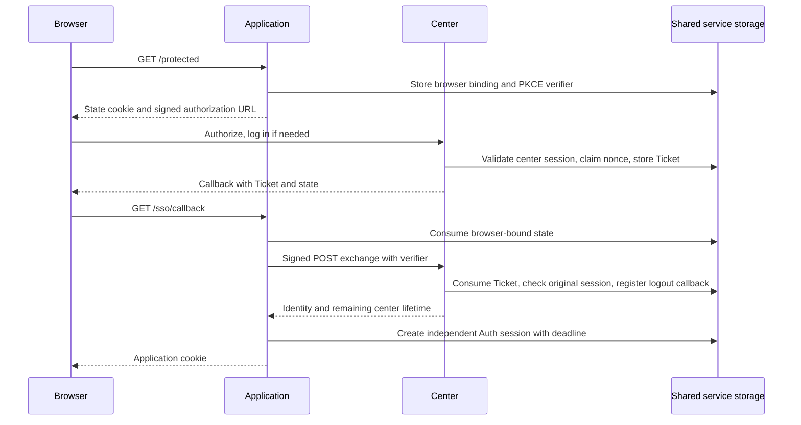

# SSO integration, deployment, and operations

[中文](DEPLOYMENT_zh.md) · [Complete example and environment variables](../examples/sso_deployment/README.md)

Use `examples/sso_deployment` as an editable integration starting point: one center, multiple applications, signing, replay protection, and PKCE enabled together. Its fixed-account demonstration authenticator must be replaced with your existing account/password verification and login controls before production. This guide covers SSO responsibilities without adding an identity database or performing deployment.

## State and request flow



The center cookie is never passed to an application. Credentials carry a hash reference to the original center token; exchange resolves that reference through the center Auth index. Another browser's newer login cannot substitute for that session. Each app creates its own opaque Auth token and enforces its deadline in storage/application logic. Signed logout callbacks revoke all local sessions for the subject. A lifetime snapshot taken at login does not provide continuous center validation.

| State | Example prefix / owner | Replica requirement |
| --- | --- | --- |
| Center Auth sessions and account indexes | `sso-example:<namespace>:center:auth:` | Shared by center replicas |
| Client registrations, Tickets, logout versions, callback records | `...:center:protocol:` | Shared by center replicas |
| Center request nonces | `...:center:replay:` | Shared and retained through the acceptance window |
| Application Auth sessions and account indexes | `...:client:<id>:auth:` | Shared by that app's replicas |
| Browser state and verifier | `...:client:<id>:flows:` | Shared by that app's replicas; five-minute default |
| Application logout callback nonces | `...:client:<id>:replay:` | Shared by that app's replicas |

Services may use separate Redis instances/accounts. Prefixes isolate keys, not Redis access permissions. Each process opens one storage adapter and lends it to Auth, SSO, BrowserClient, and replay protection; the process closes it last. The existing Redis adapter provides atomic claims/consumption. No new Redis dependency version or custom-storage transaction requirement is introduced.

## HTTPS and process deployment

1. Assign separate origins such as `https://login.example.com`, `https://alpha.example.com`, and `https://beta.example.com`. Browsers and servers must reach the relevant public URLs: apps exchange credentials at the center; the center calls application logout endpoints.
2. Provision independent exchange/signing secrets per app and cookie keys per service. Replicas of a service use identical keys. Center registrations must match their app's exchange/signing keys. Length validation cannot establish randomness; documentation placeholders are not usable secrets.
3. Set `SSO_DEV=false`, Redis URLs, public origins, and registrations. Inject only the settings needed by each process; clients do not need the full center registration array or other apps' keys. Cookies are host-only, HttpOnly, SameSite=Lax, and automatically Secure for HTTPS public origins.
4. After setting the [environment variables](../examples/sso_deployment/README.md), run each role in its own process. For local-only verification use `local.ps1`; it deliberately forces memory storage and public demonstration keys and is not a deployment script.

```powershell
# From the repository root, with independent process environments.
go run ./examples/sso_deployment -role center
go run ./examples/sso_deployment -role client
```

To create a binary in a configured build environment:

```powershell
go build -o ./sso-deployment.exe ./examples/sso_deployment
```

Use an output name such as `sso-deployment` on Linux. These commands were not run in this implementation pass. Workspace Go requirements come from `go.work`; standalone module builds must also resolve local replace paths or published modules.

5. Adapt the [nginx template](../examples/sso_deployment/nginx.conf.example) domains, certificate paths, and upstreams. Restrict HTTP listeners to trusted proxy networks and use valid TLS certificates without disabling certificate checks. The template preserves paths/query strings, disables automatic upstream retries, and does not rewrite Origin. Handlers validate forms against configured `SSO_PUBLIC_URL`, not untrusted forwarding headers. This example expects root origins with no path-prefix rewriting.
6. Gate traffic on readiness and run the acceptance flow below. New replicas need identical namespace, client ID, service keys, storage, and registration versions before joining the load balancer. Application state does not require sticky sessions.

Every center startup overwrites listed registrations and leaves unlisted stored clients intact. Coordinate registry versions during rollout. Removing an application requires explicit `UnregisterClient` and handling of existing sessions/callback registrations; deleting its environment entry is insufficient.

## Probes, deadlines, and shutdown

| Item | Example behavior |
| --- | --- |
| `GET /health/live` | Reports process routing availability, independent of Redis |
| `GET /health/ready` | Pings local configured storage with a one-second context; bounded HTTP 503 on failure |
| Readiness scope | Does not verify center reachability, callback networking, matching keys, or your real identity provider |
| Request limits | 32 KiB headers and 64 KiB bodies |
| HTTP timeouts | Header 5 seconds, read 15, write 60, idle 60 |
| App-to-center HTTP | Ten-second total client timeout |
| Center notifications | Concurrency 4; at most two attempts per target; two-second per-attempt timeout |
| Shutdown | Ctrl+C/SIGTERM stops admission; allows 45 seconds to drain connections, then force-closes them; waits for handlers to return before releasing services/storage |

The 45 seconds bound connection draining, not handler completion after forced closure. Hooks and storage calls must honor cancellation; an unresponsive handler can delay process exit, so configure a supervisor hard-stop deadline separately. Adjust proxy, HTTP, delivery, and process-manager termination deadlines together when introducing slower business operations. Forced termination can interrupt a logout and does not roll back callbacks already delivered; retries need newly generated requests. The template permits only local access to health routes; adapt that allow-list for your probe network.

Center and client sessions both enforce the stored absolute `ssoDeadline`. Authorization and exchange reject an expired original center session; exchange lifetime is capped by both Auth TTL and that absolute deadline. Increasing the stored Auth TTL does not extend the original deadline.

The example canonicalizes configured origin host case, IP spelling, and default ports before comparing center/client origins and generating `/sso/callback` registrations. Callback userinfo is rejected before normalization. Core authorization still requires an exact registered redirect URI.

Application logs include startup origins and bounded logout diagnostics, without full request URLs. The nginx template logs `$uri`, not `$request`/`$request_uri`, cookies, bodies, or signed queries, and limits error logging to critical severity. Apply equivalent filtering to other proxies/APM. Use `OnLogoutResult` to count failures, attempts, and stages without logging full configuration objects.

## Logout and failure handling

| Symptom | Response |
| --- | --- |
| Signature failure / 401 | Check client ID, dedicated signing key, parameter names, and replay settings on both ends |
| Timestamp-window failure | Synchronize clocks and begin a fresh login; do not cache authorization URLs as durable login links |
| Missing/consumed browser state | Restart at `/protected`; inspect cookie keys, Secure/origin settings, and shared replica storage |
| Failed exchange or lost response | Restart login; Tickets/Codes are consumed once, and old request bodies must not be blindly retried |
| Automatic login after local logout | Expected while center login remains valid; use Global logout to revoke all participating sessions |
| Logout callback failure | Strict policy retains center login/registrations; some apps may already be logged out. Recover the target and generate a new global-logout request; callbacks must be idempotent |
| Redis failure | Readiness returns 503; restore storage. There is no memory fallback or validation bypass |
| Intermittent state loss across replicas | Compare namespace, role, client ID, storage, keys, and configuration version |

Optional VerificationKey enables a second verification key; coordinate preparation, switching and retirement on both sides as described in [key rotation](SIGNING_ROTATION.md). Rotating cookie keys invalidates existing cookies. Changing namespace switches state collections and is not a revocation mechanism. Evicting nonce or logout-version records can break replay/revocation guarantees; size and configure Redis persistence/eviction so these records remain available through credential lifetimes.

Administrative Auth logout alone does not deliver SSO notifications. Trusted backend code can use the example's `centerHTTP.LogoutAccount(r, authorizedLoginID)` to compose center-session revocation, SSO credential invalidation, notifications and recoverable failures; no public management route is added. Suspension still requires application-owned controls blocking new login/authorization. See [account logout](ACCOUNT_LOGOUT.md) for integration and retry boundaries. [Dynamic authorization](AUTHORIZATION_POLICY.md) and [remote authentication](REMOTE_AUTH.md) serve different continuous-access requirements without being forced into this Ticket example.

## Acceptance and regression

First verify startup rejection for missing signing keys, duplicate client IDs, and non-HTTPS deployment origins. Then exercise Alpha/Beta login, local logout, global logout, strict failure with an app stopped, and a fresh retry after recovery. Redis acceptance should also cover different replicas for begin/callback, session continuity after restart, and readiness 503 during an outage.

Most regression sources use real handlers and an in-process transport. The shutdown regression opens a temporary loopback listener when executed:

```powershell
go test ./examples/sso_deployment/... -v
go test ./sso/... -v
```

They cover configuration boundaries, safe diagnostics, multi-app isolation, shared replica state/sessions, consumed callbacks, forged logout notifications, global account invalidation, login/logout origin checks, probes, and borrowed storage ownership. This pass performed source review, formatting, and link checks only; tests, Redis, browser, and nginx integration remain unexecuted.

See the [release checklist](RELEASE_CHECKLIST.md) for consolidated regression commands and outstanding runtime acceptance.

For stage-by-stage HTTP checks against running services, browser/parallel-tab checks and service/Redis recovery, see [deployment acceptance and recovery](../examples/sso_deployment/ACCEPTANCE.md). Live access is disabled by default and requires operator opt-in. Documentation and fixture presence do not establish a passing deployment.
