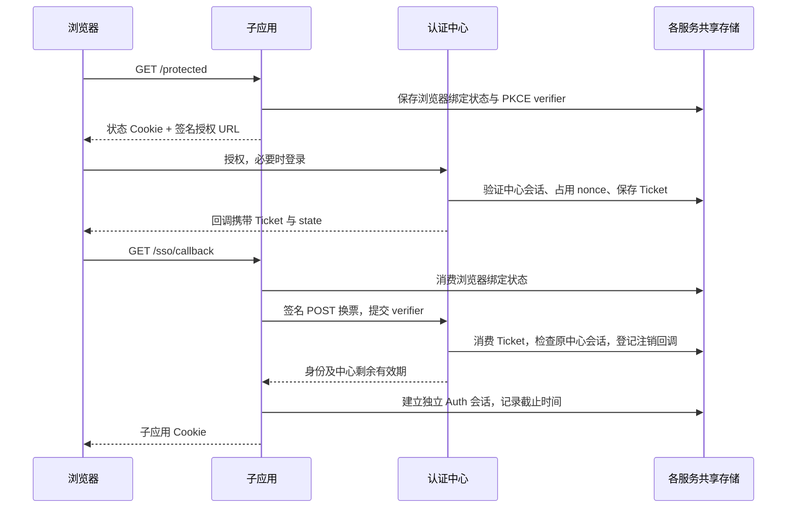

# SSO 接入、部署与运维

[English](DEPLOYMENT.md) · [完整示例与环境变量](../examples/sso_deployment/README_zh.md)

本文以 `examples/sso_deployment` 为可修改的接入起点：一个中心、多个子应用，统一开启签名、防重放与 PKCE。示例使用固定账号演示身份核验；真正部署前，应接入已有账号认证、密码验证与登录限流。本页涵盖 SSO 接入职责，不提供新的身份数据库或自动部署操作。

## 状态与调用链



中心 Cookie 不向子应用传递。中心凭证绑定的是原中心 Token 的哈希引用，换票时通过中心 Auth 索引核验原会话；重新登录的其他浏览器不能替代该会话。子应用保存自己的不透明 Auth Token，并在服务端检查期限。后续中心注销由签名回调删除子应用账号的全部本地会话；仅同步登录时的 TTL 不等于每次请求都检查中心。

| 状态 | 示例中的存储前缀／归属 | 扩容要求 |
| --- | --- | --- |
| 中心 Auth 会话及账号索引 | `sso-example:<namespace>:center:auth:` | 所有中心副本共用 |
| 客户端注册、Ticket、注销版本及回调登记 | `...:center:protocol:` | 所有中心副本共用 |
| 中心接收请求的 nonce | `...:center:replay:` | 整个接受窗口内共享并保留 |
| 子应用 Auth 会话及账号索引 | `...:client:<id>:auth:` | 同一应用副本共用 |
| 浏览器状态与 verifier | `...:client:<id>:flows:` | 同一应用副本共用，默认五分钟 |
| 子应用接收注销回调的 nonce | `...:client:<id>:replay:` | 同一应用副本共用 |

可以用不同 Redis 实例／账号隔离服务。前缀用于键隔离，不是 Redis 权限边界。示例单进程只创建一个存储适配器，Auth、SSO、BrowserClient、防重放组件均借用它；进程负责最后关闭。已有 Redis 适配器提供原子占用与消费，示例没有新增 Redis 客户端依赖版本，也不要求自定义存储新增事务能力。

## HTTPS 与进程部署

1. 为中心和应用分配独立来源，例如 `https://login.example.com`、`https://alpha.example.com`、`https://beta.example.com`。浏览器、子应用服务器和中心服务器都必须能够访问相应公开地址：子应用访问中心换票，中心访问应用注销回调。
2. 由密钥管理系统提供每应用独立的兑换密钥、签名密钥，以及每服务独立的 Cookie 密钥。同一服务的副本保持相同值。中心注册项与对应应用的交换／签名密钥精确匹配。示例的长度检查不能判断随机性；不要把文档占位符作为真实密钥。
3. 设置 `SSO_DEV=false`、`SSO_REDIS_URL`、公开地址和注册配置。每个进程只注入自身需要的配置；子应用不需要中心的完整客户端数组，也不需要其他应用的密钥。中心／应用 Cookie 均为 Host-only、HttpOnly、SameSite=Lax；HTTPS 公开地址自动启用 Secure。
4. 根据[变量表](../examples/sso_deployment/README_zh.md)注入环境后，分别执行下列命令。只做本机联调时使用该目录的 `local.ps1`，不要拿它部署：它会强制内存模式和公开演示密钥。

```powershell
# 从仓库根目录执行，每个服务使用独立进程环境。
go run ./examples/sso_deployment -role center
go run ./examples/sso_deployment -role client
```

需要生成部署二进制时，在配置好的构建环境中执行：

```powershell
go build -o ./sso-deployment.exe ./examples/sso_deployment
```

Linux 可把输出名改为 `sso-deployment`。以上命令没有在本轮执行。工作区 Go 版本遵循 `go.work`；模块独立构建时还需确保本地 replace 路径或已发布模块可解析。

5. 修改[nginx 模板](../examples/sso_deployment/nginx.conf.example)的域名、证书和上游地址。HTTP 服务仅暴露给可信代理／网络，公开 TLS 使用有效证书，禁止跳过证书校验。模板保留原路径及查询串，关闭上游自动重试，不改写 Origin。应用按固定 `SSO_PUBLIC_URL` 检查表单来源，不依赖不可信的 `X-Forwarded-*` 推导来源。示例只支持根来源，不做路径前缀重写。
6. 健康探测通过后再接流量，按下面的验收流程走完整登录及退出。新增副本应先设置相同环境名、客户端 ID、Cookie／签名密钥和存储，再加入负载均衡；应用侧状态不依赖粘性会话。

中心初始化会覆盖数组中对应的客户端记录，且不删除未列出的旧记录。滚动更新时统一注册版本；删除接入应用需显式 `UnregisterClient`，并处理既有会话和注销登记，不能仅删环境变量。

## 探测、时限和退出

| 项目 | 示例行为 |
| --- | --- |
| `GET /health/live` | 只报告进程路由存活，不依赖 Redis |
| `GET /health/ready` | 一秒上下文内 Ping 本进程存储；失败返回 503 固定文本 |
| 就绪检查边界 | 不验证远端中心、回调网络、两端密钥是否相同或真实账号系统 |
| 请求大小 | Header 上限 32 KiB；正文上限 64 KiB |
| HTTP 时间 | Header 5 秒、读 15 秒、写 60 秒、空闲 60 秒 |
| 子应用到中心 | 客户端 HTTP 总超时 10 秒 |
| 中心通知 | 并发上限 4，每目标最多 2 次，每次通知超时 2 秒 |
| 退出 | Ctrl+C／SIGTERM 停止接收请求，连接排空宽限期为 45 秒；超时强制关闭连接，等待在途处理器返回后再释放组件和存储 |

45 秒仅限制连接排空，不限制强制关闭后等待处理器退出的时间。业务钩子和存储调用应响应取消；不退出的处理器可能阻止进程结束，进程管理器的强制终止期限需单独配置。接入真实慢操作时应一并调整代理、HTTP、通知和进程管理器的终止宽限期。强制退出可能中断已开始的注销；不会回滚已成功发送的回调，重试需重新生成请求。模板对健康端点仅允许本机代理访问，应按实际探针网络修改允许列表。

中心与子应用会话统一检查存储中的绝对截止时间 `ssoDeadline`。授权及换票拒绝已超过该期限的原中心会话；换票有效期同时受 Auth TTL 和绝对截止时间限制，单独延长 Auth TTL 不会延长原截止时间。

示例在比较中心／子应用来源和生成 `/sso/callback` 注册地址前，统一主机大小写、IP 写法与默认端口；规范化前先拒绝回调中的用户信息。核心授权协议仍要求重定向地址与注册值精确匹配。

日志只记录启动来源、注销阶段和失败客户端摘要。应用没有请求 URL 访问日志；nginx 模板只记录 `$uri`，不记录 `$request`／`$request_uri`、Cookie、请求体和签名参数，错误日志限制为 critical。其他代理／APM 也应避免保存授权及回调查询串。指标可通过已有 `OnLogoutResult` 统计通知失败、重试次数和阶段，诊断时不要输出整个配置。

## 统一注销与故障处理

| 现象 | 处理方式 |
| --- | --- |
| 签名失败／401 | 核对客户端 ID、独立签名密钥、参数及双方防重放开关；不要关闭验签来掩盖配置错误 |
| 时间窗口错误 | 同步系统时钟，从应用重新开始登录；授权 URL 不是可长期缓存的入口 |
| 浏览器 state 缺失或已消费 | 从 `/protected` 开始新流程；检查 Cookie 密钥、Secure、来源和跨副本存储 |
| 换票失败或响应丢失 | 重新登录；Ticket／Code 一次性消费，不缓存重发旧请求 |
| 本地退出后又自动登录 | 中心会话仍有效，属于本地退出的预期行为；需要全部退出时使用 Global logout |
| 子应用回调失败 | 严格策略保留中心会话／回调登记。部分子应用可能已退出；恢复目标后生成新全局退出请求，回调处理必须幂等 |
| Redis 失败 | 就绪检查返回 503，恢复存储；不会切换到进程内存或绕过校验 |
| 副本之间偶发丢失状态 | 核对环境名、角色、应用 ID、存储、密钥及配置版本；不同服务的前缀不能混用 |

签名支持可选 VerificationKey 作为额外验签密钥，两端按准备、切换、退役阶段协调更新；详见[密钥轮换](SIGNING_ROTATION_zh.md)。轮换 Cookie 密钥会使既有 Cookie 失效；更换命名空间等同切换状态集合，不能作为旧凭证撤销方案。Redis 淘汰 nonce 或注销版本记录可能破坏防重放／撤销保证，应选择合适持久化、容量和淘汰策略，避免在凭证有效期内清理这些记录。

直接调用 Auth 管理端注销不会自动执行 SSO 通知。可信后台可通过示例持有的 `centerHTTP.LogoutAccount(r, authorizedLoginID)` 串联中心会话撤销、SSO 凭证失效、子应用通知和失败恢复；没有新增公开管理路由。账号禁用时仍须在应用身份系统中阻止新登录和授权。接入及重试边界见[账号下线指南](ACCOUNT_LOGOUT_zh.md)。已有[动态授权策略](AUTHORIZATION_POLICY_zh.md)和[远程鉴权](REMOTE_AUTH_zh.md)适用于不同的实时收权需求，不必强行把它们塞入此 Ticket 示例。

## 验收与回归

先验证配置拒绝：删除签名密钥、重复客户端 ID、使用非 HTTPS 部署来源，应在监听前失败。随后验证 Alpha／Beta 登录、单应用退出、全局退出、停止子应用后的严格失败、服务恢复后的新请求重试。Redis 联调还应验证开始登录和回调落到不同副本、重启后仍能识别既有会话、Redis 断开时就绪返回 503。

多数回归源码使用真实路由和进程内 transport；退出回归用例在执行时会临时监听本机回环端口：

```powershell
go test ./examples/sso_deployment/... -v
go test ./sso/... -v
```

源码覆盖配置边界、不回显秘密、多应用隔离、跨副本 state／会话、已消费回调拒绝、伪造注销回调拒绝、账号全局失效、登录／注销来源保护、健康探测及借用存储所有权。本批只完成静态审查、格式化与文档链接检查；测试、Redis、浏览器和 nginx 联调均尚未执行。

统一回归命令及剩余运行验收项目见[发布验收清单](RELEASE_CHECKLIST_zh.md)。

已启动环境的逐阶段 HTTP 验收、浏览器多标签页验证、停服与 Redis 恢复流程见[部署验收与故障恢复](../examples/sso_deployment/ACCEPTANCE_zh.md)。验收包默认不访问服务，实际执行由操作者显式启用；不要将文档或测试源码存在视为部署通过。
